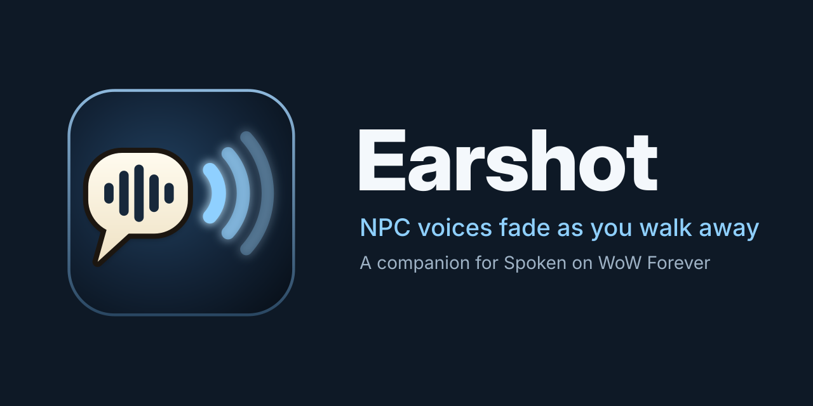
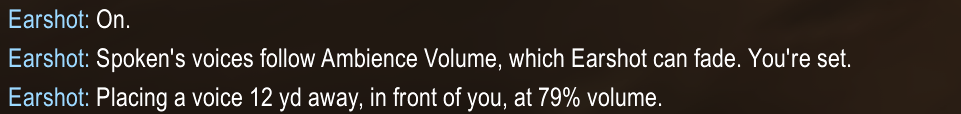
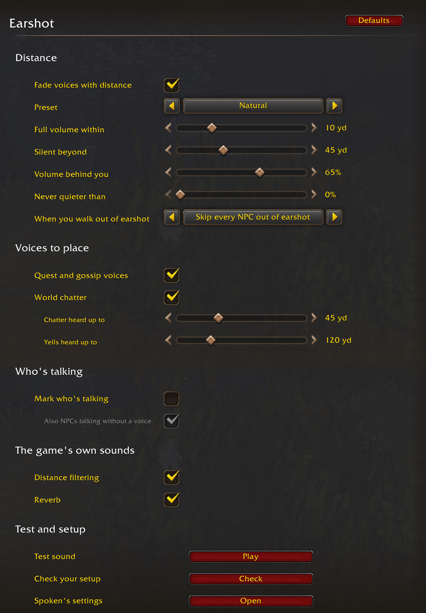

<p align="center"></p>

Earshot puts [Spoken](https://www.curseforge.com/wow/addons/spoken)'s NPC voices in the
world. Walk away from a quest giver in the middle of a line and the voice fades behind you.
Turn your back and it goes softer. Chatter comes from where the NPC said it, and yells
carry further.

## Download

Install it from [CurseForge](https://www.curseforge.com/wow/addons/earshot): the CurseForge
app installs Spoken with it and keeps both up to date.

Or download `Earshot-<version>.zip` from
[Releases](https://github.com/Squeshly-Freezed/Earshot/releases) and extract it into the
`Interface\AddOns` folder of WoW Forever, next to Spoken. GitHub's green Code > Download
ZIP button gives you the source instead, which the game won't load as it is.

Earshot needs [Spoken](https://www.curseforge.com/wow/addons/spoken).

## Setup

1. In Spoken's settings, set **Volume Follows** to **Ambience Volume** (`/earshot spoken`
   opens them). Earshot fades a voice by moving the volume slider Spoken plays on, and it
   leaves Master alone.
2. `/reload`, then `/earshot test` outdoors. Walk away and turn around: the tune fades, and
   goes softer behind you.

`/earshot status` (or **Check your setup** on the settings page) says what Earshot is doing:



The full guide, with every setting, is in [Earshot/README.md](Earshot/README.md).

## What it does

- Quest and gossip voices come from where the NPC stood, and chatter from where you were
  when the NPC spoke.
- Presets (Subtle, Natural, Dramatic), plus sliders for the distances, the volume behind
  you, and how quiet a voice may get.
- You choose what happens when you walk out of earshot: keep playing quietly, skip the
  line, skip that NPC's lines, skip every NPC out of earshot, or wait until you come back.
- A speech bubble shows who's talking. It sits on nameplates, so switch on the game's
  Friendly NPC nameplates to see it.
- Works with Spoken 3.12's Previous and Mute.

<p align="center"></p>

## How it works

The game gives addons no way to place a sound in the world or set its volume, so Earshot
moves the volume slider Spoken plays on while a line plays, and puts it back afterwards.
It knows where you are and which way you face, and where the NPC was when you talked to it
(or where you were when it spoke).

## Bugs and feedback

Report bugs in the comments on [CurseForge](https://www.curseforge.com/wow/addons/earshot) or on
[GitHub](https://github.com/Squeshly-Freezed/Earshot/issues).

## Development

Tests, the zip, and the pictures: see [DEV.md](DEV.md). In short:

```
pip install lupa
python tests/run.py
python tools/package.py
```

## Licence

MIT, see [LICENSE](LICENSE).

Earshot is a fan-made addon. It isn't made by Spoken's authors or by Blizzard
Entertainment.
